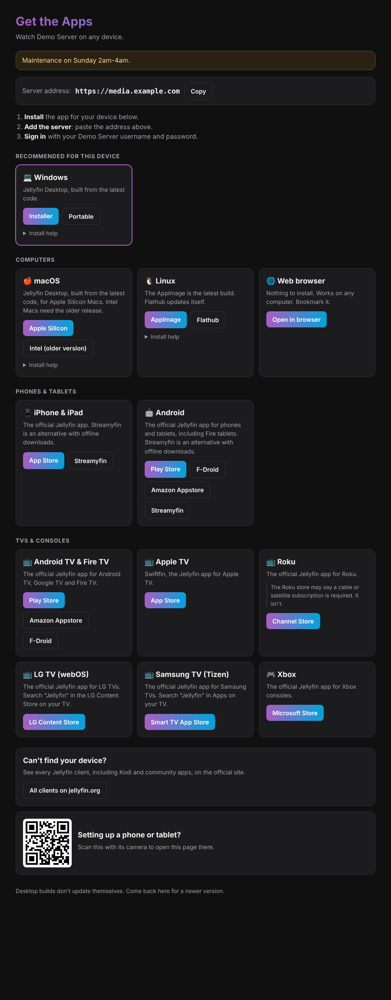

# Jellyfin Get Apps

A Cloudflare Worker that gives your Jellyfin users one page to get the right app for every device. No more sending people to GitHub.



## Features

- **Detects the visitor's device** and puts the right app at the top (iPadOS included).
- **Always the latest desktop build.** Windows, macOS and Linux links point at the newest Jellyfin Desktop build from `master` via [nightly.link](https://nightly.link), and each card shows how old that build is.
- **Every official client** from [jellyfin.org/downloads](https://jellyfin.org/downloads/clients): iPhone/iPad (App Store), Android (Play Store, F-Droid, Amazon), Android TV & Fire TV (Play Store, Amazon, F-Droid), Roku, LG webOS, Samsung Tizen and Xbox, plus Swiftfin for Apple TV and Streamyfin as a mobile alternative. Anything else links to the official site.
- **Grouped** into computers, phones & tablets, and TVs & consoles. Smart TVs and consoles are detected too (Fire TV, LG, Samsung, Xbox, Roku).
- **Copy-to-clipboard server address** and a 3-step "how to connect" guide.
- **QR code** on desktop so people can open the page on their phone.
- **Short links** like `/go/windows` or `/go/roku` that you can send in a message.
- **Optional banner** for announcements (maintenance, new users, etc.).
- **Hide** any platform or button you don't want to offer.
- **Embeds inside Jellyfin** (e.g. via KefinTweaks custom menu links). The page sets `frame-ancestors` so only your server can frame it.
- No tracking, `noindex`, one small Worker with no bindings. Fits the free plan.

## Configuration

Nothing about your server lives in this repo. Set these in the Cloudflare dashboard under **Worker → Settings → Variables and Secrets**. Use the **Secret** type if you'd rather the values stay hidden in the dashboard too.

| Name | Required | Example | What it does |
|---|---|---|---|
| `SERVER_URL` | Yes | `https://jellyfin.example.com` | Your Jellyfin address. Shown with a copy button and used for the web link. |
| `SERVER_NAME` | No | `My Media` | Name shown on the page. Defaults to `Jellyfin`. |
| `ANNOUNCEMENT` | No | `Maintenance Sunday 2–4am` | Shows a banner at the top. |
| `AMAZON_DOMAIN` | No | `amazon.co.uk` | Amazon store for the Amazon Appstore links. Defaults to `amazon.com`. |
| `HIDE` | No | `xbox,android-fdroid,streamyfin-ios` | Comma-separated platform or button ids to hide (see `/api/clients`). |
| `FRAME_ANCESTORS` | No | `'self' https://jellyfin.example.com` | Who may embed the page. Defaults to the origin of `SERVER_URL`. |
| `GITHUB_TOKEN` | No | (secret) | Only if the build dates stop showing because of GitHub rate limits. No scopes needed. |

`wrangler.jsonc` has `keep_vars: true`, so deploys never wipe these.

## Deploy

### Option A: from the Cloudflare dashboard (auto-deploys on every push)

1. Fork this repo.
2. **Workers & Pages → Create → Import a repository**, pick your fork, and deploy.
3. Add the variables above under **Settings → Variables and Secrets**.
4. **Settings → Domains & Routes → Add → Custom domain**, e.g. `apps.example.com`.

### Option B: from your machine

```sh
npm install
npx wrangler login
npx wrangler secret put SERVER_URL
npm run deploy
```

If you already have a Worker, change `name` in `wrangler.jsonc` to match it.

Use a **custom domain** rather than a route: Cloudflare creates the DNS record and certificate for you, including for deeper subdomains like `install.client.example.com`.

## Add it to Jellyfin (KefinTweaks)

In **KefinTweaks → Custom Menu Links JSON**:

```json
[
  {
    "name": "Get the Apps",
    "icon": "install_desktop",
    "url": "#/userpluginsettings.html?pageUrl=https://apps.example.com/",
    "openInNewTab": false,
    "sideMenu": false,
    "topNavigation": "none",
    "userMenu": true
  }
]
```

This adds "Get the Apps" to the profile menu (top-right avatar), and opens the page inside Jellyfin. The `pageUrl` route needs the Plugin Pages plugin; without it, use `"url": "https://apps.example.com/"` with `"openInNewTab": true`.

The link shows in clients that use jellyfin-web (browser, Jellyfin Desktop, the official mobile apps), not in native apps like Swiftfin, Streamyfin, Android TV or Roku.

You can also add a line to **Dashboard → General → Branding → Login disclaimer** so new users see it before signing in:

```html
New here? <a href="https://apps.example.com/" target="_blank">Get the apps →</a>
```

## Endpoints

| Path | Returns |
|---|---|
| `/` | The page. `?platform=` forces a device: `windows`, `mac`, `linux`, `ios`, `android`, `androidtv`, `appletv`, `roku`, `webos`, `tizen`, `xbox`. |
| `/go/<id>` | Redirect to one download, e.g. `/go/windows`, `/go/android`, `/go/firetv`, `/go/roku`, `/go/lg`, `/go/samsung`, `/go/xbox`, `/go/web`. |
| `/api/clients` | Every platform and link as JSON. |
| `/api/builds` | Date and commit of the latest desktop builds (cached for an hour). |
| `/qr.svg` | QR code for the page. |
| `/health` | `{ "ok": true, "configured": true }` |

## Development

```sh
npm install
cp .dev.vars.example .dev.vars   # fill in your values
npm run dev                      # http://localhost:8787
npm test
```

App links live in [`src/clients.js`](src/clients.js). Change them there to add or swap a client.

## Notes

- Desktop builds from `master` don't auto-update. The footer reminds users to come back.
- Intel Macs aren't built on `master` any more, so the Intel button points at v1.12.0, the last release with an Intel build.

## License

MIT. Not affiliated with the Jellyfin project.
